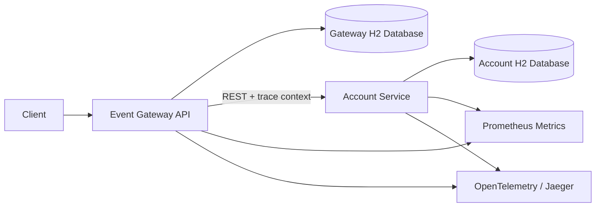
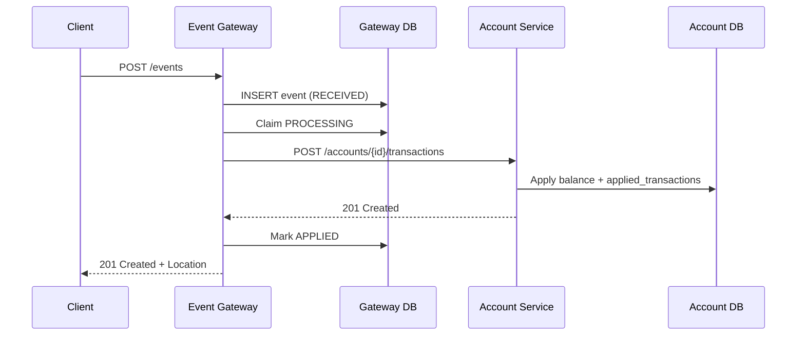
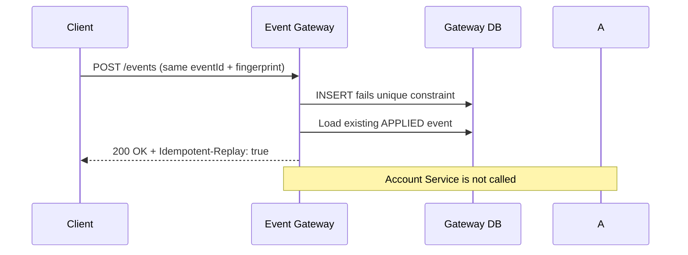
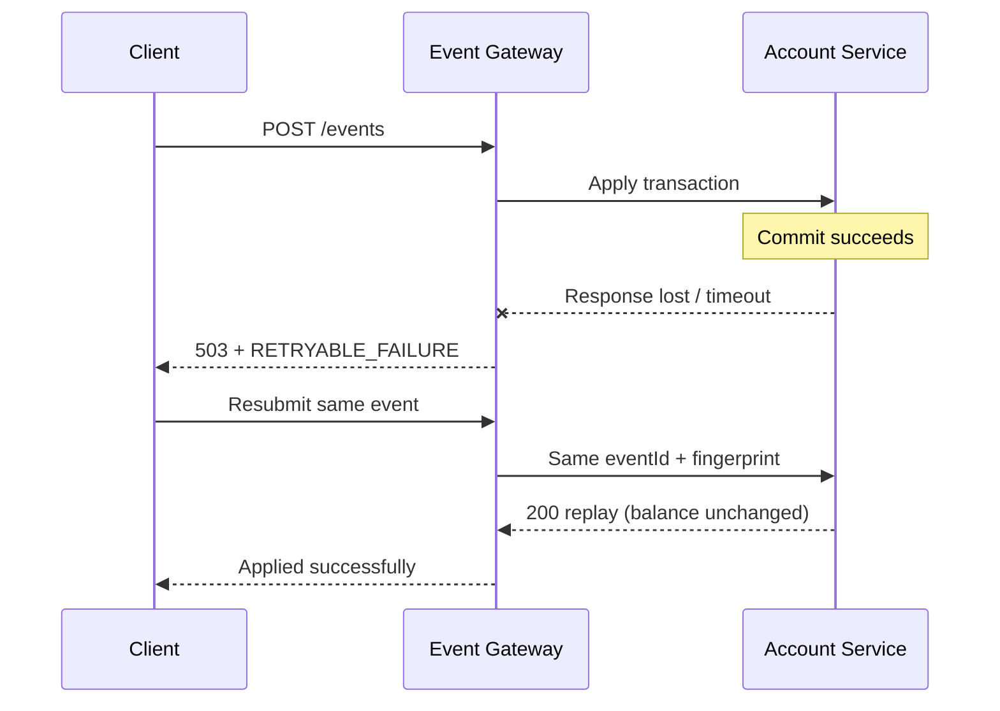

# Event Ledger

A reliable two-service financial event processing system demonstrating idempotency, concurrency control, distributed tracing, resilience, observability, and graceful degradation.

[](https://openjdk.org/projects/jdk/21/)
[](https://spring.io/projects/spring-boot)
[](https://maven.apache.org/)
[](./.github/workflows/build.yml)
[](./LICENSE)

## Why this solution is differentiated

- **Two-level idempotency** — Gateway and Account Service each enforce unique `eventId` constraints.
- **Request fingerprint conflict detection** — Same ID with a different payload returns `409`, never silently overwrites.
- **Concurrency-safe account updates** — Optimistic locking with bounded retry and atomic balance + ledger write.
- **Uncertain downstream outcome handling** — Lost HTTP responses after Account commit still mutate balance at most once.
- **Bounded resilience** — Timeouts, retry with jitter, circuit breaker, and bulkhead around the downstream call only.
- **Distributed tracing** — W3C `traceparent` propagation with JSON logs carrying `traceId` / `spanId`.
- **Production-style automated tests** — Unit, repository, WireMock failure injection, concurrency, and Compose smoke coverage.

## Table of contents

- [Architecture](#architecture)
- [Sequence diagrams](#sequence-diagrams)
- [Quick start](#quick-start)
- [API documentation](#api-documentation)
- [Idempotency and correctness](#idempotency-and-correctness)
- [Resilience](#resilience)
- [Observability](#observability)
- [Testing](#testing)
- [Security](#security)
- [Documentation map](#documentation-map)
- [Production evolution](#production-evolution)

## Architecture



| Component | Port | Responsibility |
|-----------|------|----------------|
| `event-gateway` | 8080 | Public event API, validation, fingerprinting, processing state machine, resilience |
| `account-service` | 8081 | Balance authority, transaction history, independent idempotency |
| `contract` | — | Versioned DTOs and shared pure helpers only (no runtime state) |

## Sequence diagrams

### Successful event processing



### Duplicate replay



### Uncertain downstream result



## Quick start

```bash
git clone https://github.com/<github-username>/event-ledger.git
cd event-ledger
docker compose up --build
```

Health checks:

```bash
curl http://localhost:8080/health
curl http://localhost:8081/health
```

Submit an event:

```bash
curl -i -X POST http://localhost:8080/events \
  -H "Content-Type: application/json" \
  -d '{
    "eventId": "evt-001",
    "accountId": "acct-123",
    "type": "CREDIT",
    "amount": 150.00,
    "currency": "USD",
    "eventTimestamp": "2026-05-15T14:02:11Z",
    "metadata": {
      "source": "demo"
    }
  }'
```

Duplicate replay (expect `200` + `Idempotent-Replay: true`):

```bash
curl -i -X POST http://localhost:8080/events \
  -H "Content-Type: application/json" \
  -d '{
    "eventId": "evt-001",
    "accountId": "acct-123",
    "type": "CREDIT",
    "amount": 150.00,
    "currency": "USD",
    "eventTimestamp": "2026-05-15T14:02:11Z",
    "metadata": {
      "source": "demo"
    }
  }'
```

Balance and event listing:

```bash
curl http://localhost:8081/accounts/acct-123/balance
curl "http://localhost:8080/events?account=acct-123"
```

Outage simulation and recovery:

```bash
docker compose stop account-service
curl -i -X POST http://localhost:8080/events \
  -H "Content-Type: application/json" \
  -d '{"eventId":"evt-outage","accountId":"acct-123","type":"CREDIT","amount":5.00,"currency":"USD","eventTimestamp":"2026-05-16T10:00:00Z"}'
# Expect 503; gateway reads still work:
curl http://localhost:8080/events/evt-001

docker compose start account-service
# wait until healthy, then resubmit evt-outage
```

Or use `./scripts/simulate-outage.sh` / `.\scripts\simulate-outage.ps1`.

Optional observability stack:

```bash
docker compose --profile observability up --build
```

## API documentation

Verified Springdoc paths:

| Service | Swagger UI | OpenAPI JSON |
|---------|------------|--------------|
| Gateway | http://localhost:8080/swagger-ui.html | http://localhost:8080/v3/api-docs |
| Account | http://localhost:8081/swagger-ui.html | http://localhost:8081/v3/api-docs |

Do not expose Swagger publicly in production without an explicit profile and access control.

### Example outcomes

| Status | When |
|--------|------|
| `201 Created` | New event persisted and applied |
| `200 OK` | Exact duplicate already `APPLIED` (`Idempotent-Replay: true`) |
| `400 Bad Request` | Validation / malformed JSON (`application/problem+json`) |
| `409 Conflict` | Same `eventId`, different fingerprint |
| `503 Service Unavailable` | Account unavailable / circuit open / processing in progress |

More examples: [`docs/api-examples.md`](docs/api-examples.md).

## Idempotency and correctness

**Gateway:** unique primary key on `event_id`, SHA-256 fingerprint over canonical business fields, explicit processing states (`RECEIVED` → `PROCESSING` → `APPLIED` / `RETRYABLE_FAILURE` / `PERMANENT_FAILURE`). Duplicate inserts use the DB constraint as the race authority (`Persistable` ensures INSERT, not merge).

**Account:** unique `applied_transactions.event_id` written in the same local transaction as the balance update. Optimistic locking with bounded retry handles concurrent credits/debits.

**Out-of-order:** listings sort by `eventTimestamp`, then `eventId`. Balance uses commutative credit/debit deltas, so arrival order does not corrupt totals.

## Resilience

Gateway → Account only:

- Connect timeout `500ms`, response timeout `2s`
- Retry max 3 with exponential backoff + jitter (transient IO/502/503/504 only)
- Circuit breaker (window 10, min calls 5, 50% threshold)
- Bulkhead (20 concurrent, no wait)
- Per-instance POST rate limit (Bucket4j)

Choice rationale: timeouts prevent hangs; bounded retry absorbs blips; the circuit breaker stops retry amplification during outages; the bulkhead protects Gateway threads. Account idempotency makes retries financially safe.

## Observability

- JSON logs via LogstashEncoder (`service`, `@timestamp`, `level`, `traceId`, `spanId`)
- Prometheus: `/actuator/prometheus`
- Actuator liveness/readiness probes
- `/health` includes service identity and database connectivity
- Optional Jaeger via Compose `observability` profile

## Testing

### Standard test suite

```bash
mvn clean verify
```

Coverage includes validation, fingerprinting, state transitions, account concurrency, WireMock outage/timeout/circuit-breaker/uncertain-commit scenarios, and traceparent propagation.

### Real dual-service integration test

```bash
mvn clean verify -Pdual-service-it
```

The optional profile starts the real Event Gateway and Account Service as
independent processes, executes the end-to-end flow, and stops both services.

Ports default to Gateway `18080` and Account Service `18081` (override with
`-Ddual.it.gateway.port=` / `-Ddual.it.account.port=`). Service stdout is kept
under `dual-service-it/target/dual-service-it/logs/`. Controlled Account Service
kill/restart during the Maven profile is intentionally omitted; outage/recovery
remains covered by WireMock ITs and the Docker Compose smoke job.

## Security

- Request size / metadata / field length limits
- ProblemDetail errors without stack traces
- Actuator limited; shutdown disabled; H2 console disabled
- Non-root containers
- See [SECURITY.md](SECURITY.md) and [CONTRIBUTING.md](CONTRIBUTING.md)

Authentication is an intentional external production concern for this assignment.

## Documentation map

| Doc | Purpose |
|-----|---------|
| [DECISIONS.md](DECISIONS.md) | Architecture decision records |
| [WALKTHROUGH.md](WALKTHROUGH.md) | 10–15 minute interview script |
| [IMPLEMENTATION_PLAN.md](IMPLEMENTATION_PLAN.md) | Build phases |
| [SUBMISSION_CHECKLIST.md](SUBMISSION_CHECKLIST.md) | Submission + release checklist |
| [ASSIGNMENT_ALIGNMENT.md](ASSIGNMENT_ALIGNMENT.md) | Official PDF requirement map |
| [GITHUB_READINESS.md](GITHUB_READINESS.md) | Public GitHub readiness report |
| [docs/architecture.md](docs/architecture.md) | Architecture deep dive |
| [docs/failure-scenarios.md](docs/failure-scenarios.md) | Failure playbook |

## Production evolution

1. PostgreSQL (or managed SQL) with HA, backups, and encryption.
2. OAuth2/JWT or mTLS, TLS everywhere, secrets management.
3. Durable outbox / retry worker for `RETRYABLE_FAILURE`.
4. Distributed rate limiting and multi-instance deployment.
5. SLOs, alerting, chaos testing, and continuous dependency/container scanning.

## Explicit design “why”

- **Database constraints** remain correct under races and restarts; pre-insert reads do not.
- **No remote call inside a local DB transaction** — avoids lock contention and false atomicity.
- **No exactly-once network claim** — lost responses are inherent; Account idempotency gives at-most-once mutation.
- **Two idempotency layers** — Gateway owns client event semantics; Account owns the financial side effect.
- **H2** is an assignment constraint, not a production recommendation.
