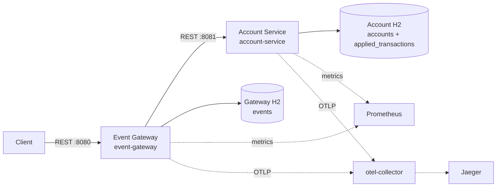
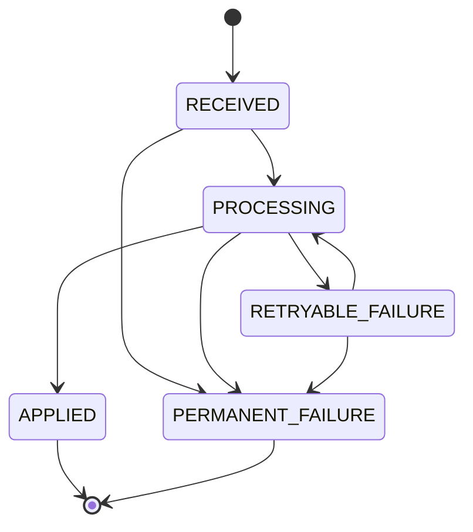

# Event Ledger

Event Ledger accepts financial credit/debit events and applies each logical event to an account balance at most once, despite client retries, concurrent submissions, and the case where a downstream commit succeeds but its response is lost. It is a Maven reactor targeting Java 21 / Spring Boot 3.3.5.

## Problem summary

The public API must provide a durable answer for an `eventId`: apply a valid event once, replay a completed duplicate, reject a conflicting reuse of the ID, and preserve a retryable record when Account Service is unavailable. This implementation uses two independently deployed REST services and separate H2 databases; it deliberately does **not** claim distributed exactly-once delivery.

## Architecture



### Components and responsibilities

| Component | Responsibility |
|---|---|
| `contract` | Versioned DTOs, `EventType`, processing states/transitions, validation helpers, and the request fingerprint algorithm. It holds no runtime state. |
| `event-gateway` (8080) | Public event API, gateway-side idempotency record/state machine, fingerprint conflict detection, rate limiting, Account REST client, retry/circuit-breaker configuration, and event queries. |
| `account-service` (8081) | Internal account/balance authority. Atomically writes a balance change and the applied-event record, then replays or conflicts duplicate transaction requests. |
| Separate H2 files | Gateway: `./data/gateway-db`; Account: `./data/account-db`. Docker mounts them separately at `/app/data`. Flyway owns the schemas. |
| Optional observability stack | `prometheus`, `grafana`, `otel-collector`, and `jaeger` Docker Compose services under profile `observability`. |

## Request flow

1. `POST /events` validates and canonicalizes the input, calculates a SHA-256 fingerprint, then inserts the gateway event record in a short local transaction.
2. A duplicate primary-key insert loads the stored record. A different fingerprint returns `409`; an `APPLIED` record returns `200` with `Idempotent-Replay: true`.
3. The gateway claims an eligible event (`RECEIVED` or `RETRYABLE_FAILURE`) in another short transaction, changing it to `PROCESSING`.
4. Outside any gateway database transaction, it calls `POST /accounts/{accountId}/transactions`.
5. Account Service atomically updates/creates the account and inserts `applied_transactions.event_id`. It returns `201`, or `200` plus `Idempotent-Replay: true` for the same transaction/fingerprint.
6. The gateway records `APPLIED` in a final short transaction. Transient downstream failures instead become `RETRYABLE_FAILURE` and are returned as `503` with `Retry-After: 1`.

## API and status codes

### Gateway

| Endpoint | Outcome |
|---|---|
| `POST /events` | `201 Created` for a newly accepted/applied event; `200 OK` + `Idempotent-Replay: true` for an applied duplicate; `409` for a conflicting event ID; `400` for invalid input; `429` when the gateway-wide POST bucket is exhausted; `503` when processing is in progress or Account Service is unavailable. |
| `GET /events/{eventId}` | `200` with the persisted event, or `404`. |
| `GET /events?account={id}&page=0&size=20` | `200`; `size` must be 1–100 and results sort by `eventTimestamp`, then `eventId`. |
| `POST /internal/events/{eventId}/retry` | Available only when `eventledger.internal-retry.enabled=true`; retries only `RETRYABLE_FAILURE` and returns `200`. Disabled by default. |
| `GET /health` | Process liveness convenience endpoint. |

### Account Service

| Endpoint | Outcome |
|---|---|
| `POST /accounts/{accountId}/transactions` | `201 Created` after a new atomic application; `200` + `Idempotent-Replay: true` for same event/fingerprint; `409` for fingerprint or account-currency conflict; `400` for invalid data/path mismatch. |
| `GET /accounts/{accountId}/balance` | `200`, or `404`. |
| `GET /accounts/{accountId}` | `200` with ordered transaction history, or `404`. |
| `GET /health` | Account process health convenience endpoint. |

Both services expose `/actuator/health`, `/actuator/health/liveness`, `/actuator/health/readiness`, `/actuator/prometheus`, `/actuator/metrics`, and `/actuator/info`.

## Idempotency design: two levels

**Gateway level.** `events.event_id` is the primary key and stores the full request fingerprint plus processing status. This makes external retries deterministic, detects ID/payload conflicts, and gives callers a durable event status.

**Account level.** `applied_transactions.event_id` has a unique constraint and is written in the same local transaction as the balance update. It is the balance mutation authority.

Both are necessary: gateway idempotency alone cannot protect an Account Service retry after the gateway loses a response; Account idempotency alone cannot provide gateway processing state, external conflict semantics, or queryability. A database constraint—not a prior “does it exist?” read—is the race authority at each boundary.

### Request fingerprint behavior

`RequestFingerprint` hashes UTF-8 canonical fields:

`eventId | accountId | type | normalized amount | currency | canonical Instant | canonical metadata`

Amounts normalize to two decimal places; the timestamp uses canonical ISO-8601 `Instant`; metadata keys are sorted recursively and values are escaped strings. Thus metadata key order and equivalent amount scale do not change the fingerprint. The fingerprint includes `eventId`, and differs for any meaningful payload change. It is stored as a 64-character SHA-256 hex value and forwarded to Account Service.

## Processing state machine



`APPLIED` and `PERMANENT_FAILURE` are terminal. A resubmission of a retryable event may claim and retry it; a concurrent submission that encounters `PROCESSING` receives `503` rather than initiating another call.

### Partial failure: Account commits, response is lost

If Account Service commits the balance and transaction record but the HTTP response times out, Gateway marks the event `RETRYABLE_FAILURE` and returns `503`. A later submission reclaims the gateway event and sends the same `eventId` and fingerprint. Account Service finds the unique transaction record and returns a replay without changing the balance. Gateway then records `APPLIED`. This is effectively at-most-once **balance mutation**, not exactly-once distributed processing.

### Concurrency control

* Gateway `EventEntity` has optimistic versioning. Its primary key gates creation and its optimistic claim gates processing; an optimistic-lock collision becomes `PROCESSING_IN_PROGRESS`/`503`.
* Account entities use optimistic versioning. Account Service retries optimistic balance-update collisions up to 25 local transaction attempts.
* The Account transaction stores the applied-event row and account balance change together. A unique-key collision is re-read and treated as a replay only if the stored fingerprint matches.
* No remote HTTP call occurs while a local database transaction is open.

### Out-of-order event handling

Events are accepted and applied in arrival order; `eventTimestamp` is retained for history/query ordering (`eventTimestamp`, `eventId`) but does not cause a balance recomputation. An older event can therefore arrive after a newer event and still change the current balance. This is intentional for this ledger’s commutative credit/debit arithmetic; it would not be sufficient for event types whose semantics depend on temporal ordering.

## Resilience and retry rules

Gateway’s `application.yml` configures:

| Key | Value |
|---|---|
| `eventledger.account-service.connect-timeout` | `500ms` |
| `eventledger.account-service.response-timeout` | `2s` |
| `resilience4j.circuitbreaker.instances.accountService.slidingWindowSize` | `10` |
| `minimumNumberOfCalls` / `failureRateThreshold` | `5` / `50` |
| `waitDurationInOpenState` / half-open permitted calls | `5s` / `3` |
| `resilience4j.retry.instances.accountService.maxAttempts` | `3` |
| retry wait / backoff / jitter | `200ms`, multiplier `2`, randomized factor `0.5` |
| bulkhead max concurrent calls / wait | `20` / `0` |
| `eventledger.internal-retry.enabled` | `false` |
| gateway POST rate limit | 100 capacity, 100 tokens per 1 second |

The Resilience4j retry predicate retries connection/IO/timeout errors and only HTTP `502`, `503`, and `504`; it does not retry `409`, `400`, or generic `500`. The circuit breaker wraps the retry, so one logical gateway attempt can make up to three downstream calls. Client retries plus internal retries can amplify downstream load, especially during an outage; the circuit breaker, zero-wait bulkhead, rate limit, jitter, and explicit `503 Retry-After: 1` limit that pressure. The account idempotency key makes retried calls safe, but it does not make them free.

## Observability

### Distributed tracing and logs

Micrometer tracing uses the OpenTelemetry bridge with sampling probability `1.0`. The `RestClient` participates in observations and the gateway forwards an incoming `traceparent` header when present. With the Compose observability profile, OTLP reaches `otel-collector` on 4317/4318 and is exported to Jaeger.

Both services emit **JSON logs** via LogstashEncoder (`logback-spring.xml`) including timestamp, level, `service`, `traceId`, and `spanId`.

### Metrics

Prometheus is exposed at `/actuator/prometheus`. Application metric names are:

* Gateway: `event_ledger_events_received_total`, `event_ledger_events_applied_total`, `event_ledger_duplicate_replays_total`, `event_ledger_idempotency_conflicts_total`, `event_ledger_downstream_failures_total`, `event_ledger_processing_duration_seconds`
* Account: `event_ledger_transactions_applied_total`, `event_ledger_transaction_replays_total`, `event_ledger_transaction_conflicts_total`, `event_ledger_balance_update_duration_seconds`

Micrometer also publishes its normal JVM/HTTP/process metrics and Resilience4j’s Micrometer instrumentation. Every metric has the `application` tag set from `spring.application.name`.

### Health checks

`/health` is a simple process-facing endpoint used by the Docker health checks. Actuator probes distinguish liveness (“is this JVM alive?”) from readiness (“can it serve traffic?”). Gateway readiness includes its `accountService` health contributor, which calls Account Service `/actuator/health`; a downstream outage can make Gateway unready while its public `/health` still says the process is up. Account Service exposes its own enabled Actuator probes.

## Security decisions and assumptions

* Inputs are validated: positive two-decimal monetary values, uppercase ISO-4217 currency, bounded IDs/metadata, and unknown JSON properties fail deserialization.
* Error responses use RFC 9457 `ProblemDetail`, include a trace ID where available, and avoid returning stack traces.
* H2 consoles are disabled; HTTP header size is capped at 16 KB; containers run as non-root UID/GID 10001.
* Authentication, authorization, transport TLS, secret management, and ingress policy are external to this exercise—there is no Spring Security configuration. Do not expose these endpoints publicly without those controls.
* Negative balances are allowed (overdraft is a stated policy decision).
* H2 in PostgreSQL mode is a development/test constraint, not proof of production database behavior or HA durability.

## Known tradeoffs

* No XA, distributed transaction, saga, outbox, message broker, or background retry worker is implemented.
* Gateway retryable records require client resubmission or the deliberately disabled internal retry endpoint; they are not automatically drained.
* The rate limiter is one in-memory, gateway-wide bucket, not per-client and not distributed across replicas.
* The Account Service has no auth boundary in this repository.
* Request fingerprint metadata canonicalization supports nested maps; arbitrary collection/object shapes are stringified rather than normalized as full JSON.
* OpenAPI UI comes from Springdoc, but the primary contract is the code DTOs and endpoints.

## Run locally

Prerequisites: JDK 21, Maven 3.9+, Docker Compose for containers. On PowerShell:

```powershell
$env:JAVA_HOME = "C:\Path\To\jdk-21"
$env:Path = "$env:JAVA_HOME\bin;$env:Path"
java -version
mvn clean verify
```

Start the services in separate terminals after building:

```powershell
mvn -pl account-service -am spring-boot:run
mvn -pl event-gateway -am spring-boot:run
```

Or use Docker Compose:

```bash
docker compose up --build
docker compose --profile observability up --build
```

Compose service names are `account-service`, `event-gateway`, `prometheus`, `grafana`, `otel-collector`, and `jaeger`. The latter four require the `observability` profile. Run the full Maven suite with `mvn clean verify`.

### Example requests

```bash
curl --fail-with-body -i -X POST http://localhost:8080/events \
  -H 'Content-Type: application/json' \
  --data '{"eventId":"credit-001","accountId":"acct-001","type":"CREDIT","amount":100.00,"currency":"USD","eventTimestamp":"2026-07-23T12:00:00Z","metadata":{"source":"demo"}}'

curl --fail-with-body http://localhost:8080/events/credit-001
curl --fail-with-body 'http://localhost:8080/events?account=acct-001&size=100'
curl --fail-with-body http://localhost:8081/accounts/acct-001/balance
```

Use `scripts/demo.ps1` or `scripts/demo.sh` for a credit, debit, duplicate, out-of-order, and query demonstration. Use `scripts/verify-idempotency.ps1` or `.sh` to submit ten concurrent copies and verify a single `10.00` balance change.

### Simulate an Account Service failure

The provided outage scripts stop the Compose service, expect `503`, inspect the stored gateway event, restore the service, then resubmit:

```powershell
.\scripts\simulate-outage.ps1
```

```bash
./scripts/simulate-outage.sh
```

To observe circuit-breaker transitions, repeatedly submit distinct events while `account-service` is stopped. After at least five calls, a 50% failure rate in the last ten calls opens `accountService`; requests then fail fast. Start the service, wait five seconds, and make up to three probe calls to observe half-open recovery. Inspect `/actuator/metrics` or the Resilience4j Micrometer series to corroborate the state.

### Inspect metrics and traces

```bash
curl http://localhost:8080/actuator/prometheus
curl http://localhost:8081/actuator/prometheus
```

With `--profile observability`, Prometheus is at http://localhost:9090, Grafana at http://localhost:3000, and Jaeger at http://localhost:16686. In Jaeger, search for services `event-gateway` and `account-service`; send a request with a `traceparent` header or let Micrometer create a trace.

## Production evolution

1. Move to PostgreSQL (or another HA transactional database), managed migrations, backups, encryption, and retention/archival policies.
2. Add OAuth2/JWT or mTLS service identity, authorization, TLS, secrets management, audit logging, and perimeter rate limiting.
3. Replace the local rate limit with a per-principal distributed limiter; configure authentication-aware quotas.
4. Add a durable retry worker/outbox and dead-letter/operator workflow, including alerting and reconciliation of stuck `PROCESSING` records.
5. Define ledger/account semantics beyond mutable balance—currency policy, overdraft policy, immutable postings, temporal ordering, reconciliation, and compliance requirements.
6. Deploy multiple instances with load balancing, externalized configuration, SLOs/alerts, sampling policy, and chaos/load testing.

## Dependency and container scanning

No vulnerability scanner is wired into this Maven build. Scan the resolved dependencies and built images in CI, for example:

```bash
mvn -DskipTests package
trivy fs --scanners vuln,secret,config .
docker compose build
trivy image event-ledger-event-gateway
trivy image event-ledger-account-service
```

Pin scanner versions and fail CI according to an agreed severity/exception policy. Add SBOM generation and dependency scanning (for example OWASP Dependency-Check or GitHub Dependabot) as part of the production pipeline.

## Explicit design “why”

* **Why database constraints?** They remain correct under races and process restarts; application pre-checks do not.
* **Why no remote call in a local transaction?** Holding a DB transaction during network latency causes lock contention and cannot make two databases atomic.
* **Why no exactly-once claim?** A crash or lost response leaves an unavoidable uncertain outcome across REST/database boundaries; Account’s atomic idempotent write instead guarantees at-most-once balance mutation.
* **Why two idempotency layers?** Gateway owns client-facing event semantics; Account owns the side effect that must survive gateway uncertainty.
* **Why optimistic locking?** It avoids long pessimistic locks while rejecting/retrying only genuine concurrent updates.
* **Why accept out-of-order events?** The implemented credit/debit balance operation is order-independent; timestamp remains available for history ordering.
* **Why separate databases?** They model independently deployable service ownership and make the absence of a distributed transaction explicit.
